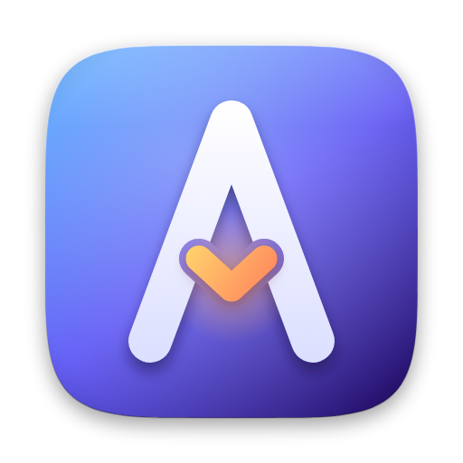

<p align="center"></p>

# avery

A private AI agent for macOS: [Goose](https://github.com/block/goose) Desktop, a local model served by
[Splash](https://github.com/incoai/splash), and a small mail and calendar bridge that reads your private Gmail or
Outlook.com mail and calendar, writes drafts, sends mail and changes calendar events, but only after you click in a
native macOS dialog. Apple Mail and Calendar can be switched on as an option.

Everything runs on your Mac. Gmail and Outlook.com (personal accounts only) are reached directly through their APIs:
Avery keeps an OAuth token for each account in your Keychain and needs the internet (see
[Gmail and Outlook.com](#gmail-and-outlookcom)). The optional Apple bridge needs no tokens: macOS keeps your credentials
and Avery never sees them (see [Apple Mail and Calendar](#apple-mail-and-calendar-optional)).

> Status: early (v0.4.0). After installing, run `avery mail selftest` and `avery mail selftest-write`.
> They check the integration with your accounts, which the automated tests cannot do.

## What is in the box

| Part | What it does |
|---|---|
| `Avery.app` | The icon in Spotlight and the Dock: starts the model, waits until it is ready and opens Goose with the Avery profile; while no account is linked, its first start guides you through the setup in dialogs |
| `avery` | Command line: creates the Goose profile, starts the model and Goose, checks the setup |
| `avery-mail` | MCP server for Goose (stdio, Rust, no dependencies) that reaches Gmail, Google Calendar and Outlook.com through their APIs (via `/usr/bin/curl`) and, only if you switch it on, Mail.app and Calendar.app through `osascript` |
| Goose profile | Config, permissions and a local provider for Splash, created by `avery init` in `~/.avery/goose`; your default Goose profile is not touched |

## Requirements

- Apple silicon Mac with macOS
- A personal Gmail and/or Outlook.com account, and an app registration of your own for it (free, a few minutes, see
  [below](#gmail-and-outlookcom)). Mail.app is needed only for the optional Apple bridge
- [Homebrew](https://brew.sh); it builds the mail server from source with Rust (1.89 or newer, installed as a build
  dependency)
- Goose Desktop (cask `block-goose`) and Splash (`incoai/tap/splash`, installed as a dependency)

## Install

Goose Desktop is a cask, so Homebrew cannot install it as a dependency of a formula:

```sh
brew install --cask block-goose
brew tap flavioaiello/avery git@github.com:flavioaiello/avery.git
brew install --cask flavioaiello/avery/avery     # Avery.app in /Applications, plus the command line as a dependency
```

The cask installs `Avery.app` from a disk image. The command line alone is the formula `flavioaiello/avery/avery`.
If the repository is public, tap it with `https://github.com/flavioaiello/avery` instead.

macOS 26 or later is required for the cask (the app icon is made for it). The app is signed ad hoc and not notarized,
because there is no Apple Developer ID behind it; the cask removes the quarantine flag so that Gatekeeper lets it start.
Only install it from a tap you trust.

## First run

```sh
avery init                # create the Goose profile in ~/.avery/goose
avery pull                # download the model once (about 17 GB); stop it with Ctrl+C when it says Ready
```

Then open **Avery** (Spotlight, or `avery up`). While no account is linked, the first start shows dialogs that guide you
through the setup (see [First start: the setup dialogs](#first-start-the-setup-dialogs)). The same steps from a terminal:

```sh
avery mail link google    # or: microsoft. Connect a personal Gmail or Outlook.com account (see below)
avery mail setup          # choose a level per account and calendar: off, read or write
avery mail selftest       # check read access
```

Everything is off until you give it a level. `write` means: drafts and sending for a mail account, creating, changing
and deleting single events for a calendar, each only after your click in a macOS dialog:

```sh
avery mail selftest-write  # test the approval dialogs: a draft, a mail to yourself, a test event, an all-day test event
```

The server reads only config format 3. A config file in any other format is rejected and never rewritten. Before you move
it away, run `avery mail unlink <address>` for every account that was linked with it: that deletes the account's token from
the Keychain, which nothing can find any more once the file is gone. If this version cannot read the file, or the file does
not list the account, name the provider: `avery mail unlink google:<address>` or `microsoft:<address>` deletes the token
without a config entry. Then move the file away (`mv ~/.avery/mail/config.json ~/.avery/mail/config.old.json`) and connect
the accounts again: `avery mail link google` or `avery mail link microsoft` for each one, then `avery mail setup`, and
`avery mail setup apple` if you use Apple Mail and Calendar. If `avery doctor` reports profile files that do not ask before
changes, `avery init --force` writes new ones (the old ones are kept as backup).

## First start: the setup dialogs

When you open Avery (`Avery.app` or `avery up`) and nothing is set up yet, native macOS dialogs guide you through the
setup before Goose starts. They are a thin layer over the very same code as `avery mail link`, `avery mail setup`,
`avery mail setup apple` and `avery mail selftest`: nothing is configured differently, and everything stays in
`config.json` and the Keychain as described below. There is no menu bar app and nothing keeps running.

1. **Welcome.** *Weiter* starts, *Später* asks again at the next start, *Nicht mehr fragen* never asks again (see below).
2. **Accounts.** Choose Gmail and/or Outlook.com. Apple Mail and Calendar is optional and off unless you tick it.
3. **Per account.** A short explanation that you need your own app registration once (*Anleitung öffnen* lets you pick
   pages and opens them in the browser: this README section and the Google Cloud or Entra console pages; the dialogs then
   end for now and the next start continues),
   the client ID (for Gmail also the client secret, which is typed hidden), the level (*Nur lesen* or *Lesen und mit Freigabe
   schreiben*), the sign-in in the browser (Avery waits at most 3 minutes and says so in a notification, if macOS shows
   notifications), and a dialog with the result: the address that is now linked, or the reason why not.
4. **Calendars.** Choose the calendars Avery may read, then which of them it may also write. A last dialog lists exactly what
   will be saved: one line for every grant that changes (not for the ones that stay as they are), the write grants first,
   under a count such as "3 Kalender zum Schreiben, 9 zum Lesen". Only *Ja* saves it. If the list does not fit into one
   dialog, it is not shown and cannot be confirmed: nothing is saved, and the next dialog says to use `avery mail setup` in a
   terminal.
5. **Apple** (only if you chose it). It first explains that macOS asks once for permission to control Mail and Calendar, then
   asks for the levels like `avery mail setup apple`, and ends with the same kind of final dialog (the terminal command for
   a list that does not fit is `avery mail setup apple`).
6. **Summary.** What is linked, and the offer to run the read check (`avery mail selftest`) now and show its result.

Every dialog can be cancelled, and cancelling means: stop, nothing more is saved. What was completed before stays
(an account that is linked and saved, calendars that you confirmed) and the last dialog says so. Every dialog also gives up
after at most ten minutes without an answer (the same as cancelling). The client secret goes from the dialog to the Keychain only:
it is never on a command line, in a log, in an error message or in `config.json`.

`avery mail onboard` shows the same dialogs whenever you want, also when everything is set up. `avery mail onboard
--if-needed` is what the launcher runs before Goose starts: it stays silent and does nothing when an account is linked or
Apple Mail and Calendar are enabled, after you chose *Nicht mehr fragen* (that creates the empty file
`~/.avery/mail/onboard.dismissed`, owner-only: delete it to be asked again), when `AVERY_NO_ONBOARD=1` is set (in the
environment or in `~/.avery/avery.env`), in demo mode and when there is no graphical session (for example over SSH). If the
dialogs cannot be shown or are cancelled, Avery still starts. `avery mail onboard` changes the configuration like
`link`, `unlink`, `setup` and `revoke`, so it refuses in demo mode.

The dialogs come from the helper `/usr/bin/osascript` and show only on the Mac's screen; the agent can neither start
them nor answer them (the server `avery-mail serve` has no code path to them). They run inside that helper and send no
Apple event to another app. macOS may still ask for a permission, for example to show notifications now, or Automation
later for the approval dialogs: allow it (System Settings > Privacy & Security).

If a step fails (for example macOS blocks the dialogs, the *Nicht mehr fragen* marker cannot be saved or `config.json`
cannot be read), the setup ends and says why: as `Fehler: ...` in a terminal and, where macOS shows notifications, as a
notification, also when `Avery.app` or `avery up` started it. If no dialog and no notification appears, run
`avery mail onboard` in a terminal: it shows the dialogs again or says why it cannot. Avery starts as usual in every
case. If you prefer the terminal, `AVERY_NO_ONBOARD=1` keeps the dialogs away and the manual steps below stay as they were.

## Gmail and Outlook.com

Avery talks to **Gmail and Google Calendar** and to **Outlook.com** (personal Microsoft accounts, also Hotmail and Live)
directly. Every account and calendar has its own level, and the model sees the same tools for all of them
(`list_messages`, `send_message`, `list_events`, ...).

**Personal accounts only.** `avery mail link google` accepts a Google account only if its address ends in `@gmail.com`
or `@googlemail.com`: Gmail means those two domains. An address that Google reports as unverified is refused too, and so
are Google Workspace accounts and Google accounts with a custom domain; nothing is stored for them. Outlook.com signs in on
Microsoft's *consumers* tenant, so work or school accounts cannot sign in. Avery itself signs in to nothing else: it never
signs in to IMAP, iCloud or Exchange accounts. Only the optional [Apple bridge](#apple-mail-and-calendar-optional) can
reach such accounts, through whatever accounts Mail.app has, and Avery never sees their credentials.

**What it means for trust.** Avery keeps the sign-in itself: a refresh token per account in the macOS Keychain (service
`avery-mail`, written and read through `/usr/bin/security`, never in a file, never on a command line; requests go
through `/usr/bin/curl` with the secrets on standard input). Whoever can run commands as you can read that token, so
keep Goose's shell and file extensions off (the profile does). Tokens are requested with the least rights: the read
level only asks for read scopes, the write level adds `gmail.compose` and `calendar.events` (Google) or
`Mail.ReadWrite`, `Mail.Send` and `Calendars.ReadWrite` (Microsoft). A direct account needs the internet.

**You register your own app.** Avery cannot ship one that Google or Microsoft trust for you, and it would not be yours.
Registering takes a few minutes and is free:

- Google: in the Google Cloud Console create a project, enable the *Gmail API* and the *Google Calendar API*, set up the
  OAuth consent screen (user type *External*, add yourself as a test user; publish the app, because in the *Testing*
  status Google lets refresh tokens expire after 7 days; unverified is fine for your own use) and create an *OAuth client
  ID* of type *Desktop app*. `avery mail link google` asks for its client ID and secret.
- Microsoft: in the Microsoft Entra admin center create an *App registration* with the account type *Personal Microsoft
  accounts only*, add the platform *Mobile and desktop applications* with the redirect URI `http://localhost`, and give
  it the delegated permissions `Mail.Read`, `Calendars.Read`, `User.Read`, `offline_access` (for the write level also
  `Mail.ReadWrite`, `Mail.Send`, `Calendars.ReadWrite`). No secret is needed. `avery mail link microsoft` asks for the
  application (client) ID.

```sh
avery mail link google          # or: microsoft. Asks for the client ID, the level, opens the browser, stores the token (the setup dialogs do the same)
avery mail setup                # per account: the mail level, then its calendars (listed live from the provider)
avery mail selftest             # read access; selftest-write tests the dialogs, a draft and a test event
avery mail unlink alice@gmail.example   # remove the account, its grants and the stored token (then remove the app in your account settings)
```

`link` adds the account to `config.json` with the mail level you chose; calendars are chosen in `setup`. Linking an
account again (for example to renew the sign-in) never raises the rights you set: it only lowers them where the new
sign-in grants less. In `setup` level 0 only takes a grant away, the account stays linked (`unlink` ends it). `revoke`
removes all grants and keeps the accounts. An address can be linked only once, under one provider, and at most 16 accounts
can be linked; linking one of them again still works at that limit. An address that Apple Mail already serves cannot be
linked directly (set that Mail account to 0 in `avery mail setup apple` first).

Differences you will notice: the provider expands recurring events itself and Avery times are read and written in this
Mac's time zone (for Outlook.com it is sent as a Windows zone name from a built-in table; a zone the table does not
know is refused); message ids are longer texts (copy them exactly); replies take their recipients and subject from the
original and carry no quoted text; Gmail search covers subject and sender.

## Apple Mail and Calendar (optional)

Avery can also drive Mail.app and Calendar.app, for accounts that you keep there. This is **off** until you switch it
on, and while it is off nothing ever starts Mail or Calendar and macOS never asks for a permission:

```sh
avery mail setup apple    # lists the Mail accounts and the calendars; you choose a level per item (0 = off)
```

This is the one command that starts Mail and Calendar. macOS asks once to let the app that runs Avery control them
(Terminal for the command line, Goose for the agent). Your choices go into the `apple` section of `config.json`; Apple is
enabled exactly when that section has entries. Later `avery mail setup` asks again only for those entries and does not
list Mail again; an account or calendar that vanished from Mail is noticed by `setup apple`, by `selftest` and by tool
errors. Setting every item to 0, or `avery mail revoke`, switches Apple off again. A Mail account whose address is
already linked directly is listed as such and stays off, because the same mailbox twice would make every account name
ambiguous.

There are no tokens: macOS holds the credentials, Avery never sees them, and Apple accounts also work offline. The
levels, dialogs, limits, logs and undo are the same as for Gmail and Outlook.com.

Calendar.app lists a recurring event only once, so Avery expands the common repeat rules (daily, weekly, monthly,
yearly with the usual parts) itself; rules it cannot expand are shown once and flagged. Reading a Calendar.app calendar
scans all of its events (up to 20000), so very large calendars are slow.

## Daily use

Open **Avery** with Spotlight (Cmd+Space) or drag it from the Applications folder to the Dock. It starts the model,
waits until it is ready and opens Goose with the Avery profile (while nothing is set up, the
[setup dialogs](#first-start-the-setup-dialogs) come first). If Goose is already open with that profile, it just
brings it to the front. When Goose has been closed for a few minutes (`AVERY_IDLE_MINUTES`, default 5), the model stops
by itself and frees its memory. There is nothing to quit and no second icon.

Without the cask, `avery install-app` creates the same app in `~/Applications`. It does nothing if the cask's app is
already in `/Applications`, so there is never a second icon.

The same works from a terminal: `avery up`. `avery down` stops the model right away.

Do not start Goose from its own Dock icon for this setup: that opens Goose's default profile, and the model is not running.

Only the model runs in the background; Goose Desktop is a normal app and starts the mail server itself when it needs it.
`avery up` uses `brew services run avery`, so the model is not started at login. A model that you started yourself, or
with `brew services start avery` (at login), is never stopped automatically. The model holds up to 28 GB of memory while
it runs. `avery model` runs it in the foreground instead (for testing). `avery doctor` shows what is missing and reports
a Goose configuration that cannot be parsed.

Restart Goose after changing accounts or permissions.

## How sending and changes are protected

The agent reads untrusted mail and calendar invitations, so the design assumes that they can try to talk the model into
doing something.

- **Levels.** Only the accounts and calendars you gave a level with `avery mail link` and `avery mail setup` are ever
  touched: `read` or `write`, set by you in a terminal or in the setup dialogs. The model cannot change them. Mail rights are per account,
  calendar rights per calendar.
- **Approval dialog.** A native dialog, shown by the server process and not by Goose, lists sender, recipients, subject
  and the exact text before a mail is sent. Recipients are never shortened: a sent mail goes only to plain ASCII
  addresses of at most 254 characters. For Gmail the server builds the message itself and sends exactly what the dialog
  showed; for Outlook.com it creates a draft, shows it, reads it again after your click and aborts if anything changed;
  with Apple Mail it builds the mail in Mail.app and reads recipients, sender, subject and text again after your click.
  Only a click on *Senden* sends. Cancel, a timeout (75 s) or any error before the click means nothing is sent. If the
  provider reports an error or does not answer after the click, the outcome is unknown: the attempt stays in the log as
  unclear and counts as sent, and the model is told to ask you to check *Sent*. The model cannot operate the dialog.
- **Calendar changes** (`create_event`, `update_event`, `delete_event`) work on single events without attendees and
  without repetition. Events with attendees (a change would notify other people) and recurring events are refused.
  The dialog shows the event as it is in the calendar and what will change (before and after); the server reads the
  event again after your click and aborts if it differs. A failure after the click is reported as an unknown outcome.
- **Goose asks too.** `permission.yaml` sets the sending and calendar change tools to `ask_before`.
- **Limits.** Mail: plain text only, no Bcc, no attachments, at most 5 recipients (also for replies to all), at most
  1500 characters and 40 lines per sent mail (longer texts must be drafts you send from your mail app), 5 sent mails per hour,
  30 drafts per hour. Calendar: title and place up to 200 characters, notes up to 1000, 10 changes per hour. For both:
  6 attempts per 10 minutes and a 20 second cool-down after you decline. Every attempt is logged before anything
  happens (`avery mail sendlog`, `avery mail changes`). If a log cannot be written or read, contains a line the server
  does not understand, or is too large to check the last hour, nothing is sent or changed until you look at it and move
  the file away. The hourly limits can be changed in `config.json` (`sends_per_hour`, `changes_per_hour`, 1 to 30).
- **Undo.** The change log keeps the event as it was before and after every change. `avery mail undo` restores it
  (a deleted event is created again; attendees and alerts do not come back). It asks for the dialog again and is not
  held back by the hourly limits, which exist for the model.
- **Hidden text.** Control, format and invisible characters (zero-width characters, line and paragraph separators,
  Unicode tag characters, variation selectors, fillers) are stripped from mail and event text the model reads and from
  text it writes, so what the dialog shows is what is stored or sent.
- **No other destructive tools.** There is no code that deletes, moves or flags mail.
- **Replies** use the account's reply: the recipients and the subject are taken from the original message.
- **No retries.** A request that fails after the click is reported as an unknown outcome and counts as sent; the server
  never repeats a send or a change on its own.
- **Subjects.** A subject with `=?` (the start of an encoded header word) is sent as plain text by Gmail and refused by
  Outlook.com; an Outlook.com answer is also refused when the subject the server built for it cannot be shown exactly
  (invisible characters, more than 300 characters).

The dialog is the hard gate. Instructions to the model (`top-of-mind.md`) are only a second line of defence.
The profile disables Goose's shell and file extensions; do not enable them for this profile.

## Commands

| Command | Purpose |
|---|---|
| `avery init [--force]` | Create the profile (existing files are kept; `--force` replaces them and keeps a backup) |
| `avery mail onboard [--if-needed]` | The guided setup in macOS dialogs, over the same code as `link`, `setup`, `setup apple` and `selftest`; `--if-needed` asks only while nothing is set up and not dismissed (what the launcher runs) |
| `avery mail link google\|microsoft` / `unlink <address>` | Connect Gmail or Outlook.com (OAuth in the browser, token in the Keychain) / disconnect it and delete the token (`unlink google:<address>` also deletes a token that has no config entry) |
| `avery mail setup` / `setup apple` / `revoke` | Choose the level (off, read, write) per account and calendar / include Apple Mail and Calendar (optional) / remove all grants (Apple off again) |
| `avery mail selftest` / `selftest-write` | Check read access / the approval dialogs, drafts, sending and a test event |
| `avery mail status` / `accounts` / `calendars` | Show configuration and levels, accounts, calendars |
| `avery mail sendlog` / `changes` / `undo [id]` | Recent send attempts / recent calendar changes / undo a calendar change |
| `avery install-app` | Create `Avery.app` in `~/Applications` without the cask (skipped when the cask's app is installed) |
| `avery up` / `avery down` | Start the model service and open Goose (it stops by itself after Goose is closed) / stop it now |
| `avery pull` | Download the model once (online, foreground; Ctrl+C when it says Ready) |
| `avery model` | Run the local model server in the foreground (no service) |
| `avery app` / `avery cli` | Start Goose Desktop / the Goose CLI with the Avery profile |
| `avery doctor` | Check prerequisites and setup |

The command line output is German for now.

## Configuration

`avery init` creates `~/.avery/avery.env` (a commented template). Known keys: `AVERY_MODEL`, `AVERY_MAX_MEMORY`,
`AVERY_MAX_CONTEXT`, `AVERY_MAX_CACHE_DISK`, `AVERY_OFFLINE`, `AVERY_IDLE_MINUTES`, `AVERY_GOOSE_APP`, `AVERY_GOOSE_ROOT`,
`AVERY_NO_ONBOARD` (1 = no setup dialogs when Avery starts). The file is parsed, not executed, and real environment variables win. The defaults are tuned for a 48 GB Mac.

The model runs offline by default (`AVERY_OFFLINE=1`): Avery never downloads anything on its own, so a service start
cannot pull a new multi-gigabyte model revision. `avery pull` is the one command that goes online.

| Path | Content |
|---|---|
| `~/.avery/goose` | Goose profile (`config/`, `top-of-mind.md`, sessions) |
| `~/.avery/mail/config.json` | Linked accounts with their levels and calendars, the optional `apple` section, hourly limits (format version 3, written by `avery mail link`, `unlink`, `setup`, `revoke` and the setup dialogs of `avery mail onboard`) |
| `~/.avery/mail/config.lock` | Empty lock file: those commands hold it only while they re-read and save `config.json` (a few milliseconds, never while you answer prompts or sign in), so two terminals never overwrite each other; a command that cannot get it within 5 seconds stops and saves nothing |
| `~/.avery/mail/vault.lock` | Empty lock file beside `config.lock`: every write of a Keychain item (`link`, `unlink`, and the renewal of a token that the provider rotates) holds it only while that one operation runs, so a renewal that is in flight can never bring back a token you just removed with `unlink` or overwrite one you just linked again (such a renewal is dropped and the call fails with a retry hint; only when another Avery process renewed the same sign-in first does the call keep the access token it got); reading a token never waits for it; a command that cannot get it within 5 seconds stops and changes nothing. It is never held together with `config.lock` |
| `~/.avery/mail/onboard.dismissed` | Empty marker file (owner-only), created when you choose *Nicht mehr fragen* in the first dialog: `avery mail onboard --if-needed` is silent while it exists. Delete it to be asked again; the config format is not involved |
| Keychain item `avery-mail` | One OAuth token per linked Gmail or Outlook.com account (never in a file) |
| `~/.avery/mail/sendlog.jsonl` | Audit log of send and draft attempts (format version 1; no mail text, only a short hash) |
| `~/.avery/mail/changes.jsonl` | Log of calendar changes with the event before and after (format version 1; used by `avery mail undo`) |

Set `AVERY_HOME` to use another base folder. The two lock files are created (owner-only) when they are missing and never
written afterwards: an existing one is only opened for reading, so a read-only lock file works and may stay as it is.

`config.json` is written by the commands above; it looks like this (you only edit the two limits by hand):

```json
{
  "version": 3,
  "accounts": [
    {
      "provider": "google",
      "address": "alice@gmail.example",
      "mail": "write",
      "calendars": [{"id": "alice@gmail.example", "name": "alice@gmail.example", "level": "write"}]
    },
    {"provider": "microsoft", "address": "bob@outlook.example", "mail": "read"}
  ],
  "apple": {
    "mail": [{"id": "0C1E9B7A", "name": "iCloud", "type": "imap", "addresses": ["me@icloud.example"], "level": "read"}],
    "calendars": [{"id": "4F8A2D11", "name": "Privat", "level": "read"}]
  },
  "sends_per_hour": 5,
  "changes_per_hour": 10
}
```

An account entry is the link: `mail` and `calendars` are optional (no `mail` means no mail access). Each address
appears once (the same address under Google and under Microsoft, or as a linked account and in the `apple` section, is
rejected) and there are at most 16 accounts. The
`apple` section is optional and only present while Apple Mail and Calendar are switched on. A calendar or Apple entry
without a `name` is shown under its `id`, cut to one line of at most 120 characters. Unknown keys are rejected. Every
change the commands make is read back with the same checks before it is saved; a file that would be refused is never
written.

## Known limitations

- Gmail, Google Calendar and Outlook.com were built against the public API documentation and tested with mocks only, not
  against real accounts. Run `avery mail selftest` and `selftest-write` after linking and look at the result.
- Google lets the unverified app of a personal project expire its refresh token after 7 days while the consent screen is
  in *Testing*; publish it (still unverified) to avoid signing in again every week.
- The setup dialogs were tested with a mock of the scripting interface and with scripted answers, not on a real screen:
  watch the first start once. If the dialogs do not show, `avery mail onboard` in a terminal says why, and
  `AVERY_NO_ONBOARD=1` with the manual steps always works.
- Personal accounts only: Google accounts must have a gmail.com or googlemail.com address (Google Workspace and custom
  domains are refused) and work and school Microsoft accounts cannot sign in. Avery itself never signs in to IMAP, iCloud
  or Exchange; only the optional Apple bridge reaches the accounts that Mail.app has.
- Mail search covers subject and sender, not the message body.
- Single events without attendees can be changed; links on events (`url`) are not supported.
- Apple bridge (optional): macOS asks for permission to control Mail and Calendar for the app that starts the server
  (Terminal for the command line, Goose for the agent); if Goose does not get the prompt, use `avery cli session` from a
  terminal. All times are local. `avery mail selftest` and `selftest-write` are the first run against the real Mail.app
  and Calendar.app on your Mac; the automated tests use demo data and a mock of the scripting interface.
- The app and the cask are for Apple silicon and macOS 26 or later; the app is not notarized.
- The model server settings assume Splash and the model named in `avery.env`.

## Development

```sh
cargo test --manifest-path avery-mail/Cargo.toml   # mail and calendar server: unit and end-to-end tests on demo data, no Mail or Calendar access
tests/cli.sh                                        # bin/avery, app builder, disk image tools, cask and formula
MAIL_MCP_FAKE=1 cargo run --manifest-path avery-mail/Cargo.toml -- status   # demo data; link, unlink, setup, onboard and revoke refuse in demo mode
AVERY_MAIL_BIN=$PWD/avery-mail/target/debug/avery-mail bin/avery doctor   # AVERY_MAIL_BIN: use another mail server binary
AVERY_DRY_RUN=1 bin/avery model   # print the command instead of running it
```

The setup dialogs and the check for a graphical session run `/usr/bin/osascript` and `/bin/launchctl`. For
`avery mail onboard` and nothing else, `AVERY_OSASCRIPT` and `AVERY_LAUNCHCTL` (absolute paths) name other programs: the
approval dialogs, the Apple bridge and the server always use the system ones and cannot reach this override. Every
binary-level test (`avery-mail/tests` and `tests/cli.sh`) points both at stand-ins that record the call in a file and fail,
and fails if a call was not expected, so a regression cannot open a real dialog. A value that is not an absolute path
leaves the dialogs dark instead of searching the `PATH`.

### Logo, app and disk image

The artwork is vector: `tools/gen-logo.js` writes `assets/avery-icon.svg` (squircle with margin, for the README and the
volume icon), `assets/avery-app-icon.svg` (full-bleed square: macOS 26 applies its own mask and edge to it, a squircle with
margin would be put on a grey plate) and `assets/avery-mark.svg` (the "A" with the flap on a transparent background).

```sh
node tools/gen-logo.js          # SVG sources
tools/render-assets.sh          # share/avery/*.icns, assets/logo.png, assets/dmg/background.tiff (needs Edge, Chrome or Chromium)
tools/make-dmg.sh               # dist/Avery-<version>.dmg: app, Applications shortcut, background, volume icon (Finder lays it out)
tools/verify-dmg.sh             # mounts the image and checks contents, signature, icon, version and window layout
tools/publish-dmg.sh            # tag dmg-v<version> with the image as its only file; pins the revision in Casks/avery.rb
```

`Avery.app` is a small AppleScript launcher (`libexec/avery-make-app`); it calls `/opt/homebrew/bin/avery up`.
The cask fetches the image with git over SSH from the tag `dmg-v<version>`, whose commit contains only that file,
because a release download from a private repository would need a token. A published tag is never moved.
Homebrew clones the whole repository, so every published image ends up in every clone of the tap (about 3.5 MB per
release). If that matters, publish the images in a separate repository or, once the repository is public, as release
assets and point the cask `url` there.

Release: bump `AVERY_VERSION` in `bin/avery` and `version` in `avery-mail/Cargo.toml` (and `Cargo.lock`), commit, tag `v<version>`, run
`tools/make-dmg.sh`, `tools/verify-dmg.sh` and `tools/publish-dmg.sh`, then pin `revision` of the tag `v<version>` in
`Formula/avery.rb`, commit and push (`git push origin main v<version>`).

## License

MIT

The table that maps IANA time zone names to Windows time zone names for the Outlook.com calendar
(`avery-mail/src/provider/graph_calendar/zones.rs`) is generated from the Unicode CLDR file
`common/supplemental/windowsZones.xml` and the links of the IANA time zone database (public domain). The CLDR data is
used under the Unicode License v3:

```text
UNICODE LICENSE V3

COPYRIGHT AND PERMISSION NOTICE

Copyright © 1991-2026 Unicode, Inc.

NOTICE TO USER: Carefully read the following legal agreement. BY
DOWNLOADING, INSTALLING, COPYING OR OTHERWISE USING DATA FILES, AND/OR
SOFTWARE, YOU UNEQUIVOCALLY ACCEPT, AND AGREE TO BE BOUND BY, ALL OF THE
TERMS AND CONDITIONS OF THIS AGREEMENT. IF YOU DO NOT AGREE, DO NOT
DOWNLOAD, INSTALL, COPY, DISTRIBUTE OR USE THE DATA FILES OR SOFTWARE.

Permission is hereby granted, free of charge, to any person obtaining a
copy of data files and any associated documentation (the "Data Files") or
software and any associated documentation (the "Software") to deal in the
Data Files or Software without restriction, including without limitation
the rights to use, copy, modify, merge, publish, distribute, and/or sell
copies of the Data Files or Software, and to permit persons to whom the
Data Files or Software are furnished to do so, provided that either (a)
this copyright and permission notice appear with all copies of the Data
Files or Software, or (b) this copyright and permission notice appear in
associated Documentation.

THE DATA FILES AND SOFTWARE ARE PROVIDED "AS IS", WITHOUT WARRANTY OF ANY
KIND, EXPRESS OR IMPLIED, INCLUDING BUT NOT LIMITED TO THE WARRANTIES OF
MERCHANTABILITY, FITNESS FOR A PARTICULAR PURPOSE AND NONINFRINGEMENT OF
THIRD PARTY RIGHTS.

IN NO EVENT SHALL THE COPYRIGHT HOLDER OR HOLDERS INCLUDED IN THIS NOTICE
BE LIABLE FOR ANY CLAIM, OR ANY SPECIAL INDIRECT OR CONSEQUENTIAL DAMAGES,
OR ANY DAMAGES WHATSOEVER RESULTING FROM LOSS OF USE, DATA OR PROFITS,
WHETHER IN AN ACTION OF CONTRACT, NEGLIGENCE OR OTHER TORTIOUS ACTION,
ARISING OUT OF OR IN CONNECTION WITH THE USE OR PERFORMANCE OF THE DATA
FILES OR SOFTWARE.

Except as contained in this notice, the name of a copyright holder shall
not be used in advertising or otherwise to promote the sale, use or other
dealings in these Data Files or Software without prior written
authorization of the copyright holder.
```
